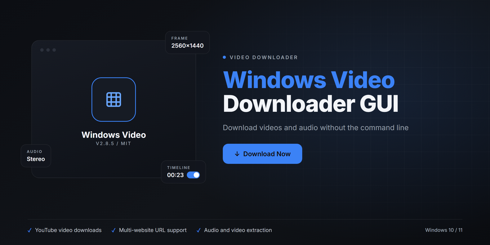
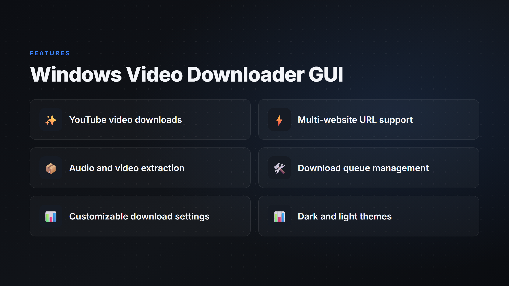

  
  
  
  
  

**Windows Video Downloader GUI is a free, open-source desktop application for downloading YouTube videos, audio, and online media from websites supported by yt-dlp.** Get a straightforward graphical download manager for Windows without having to learn terminal commands or work with complicated scripts.

## ⬇️ Installation

**Download the Windows application**

1. Open the repository's [Releases](https://github.com/emberkite095/windows-video-downloader-gui/releases) page.
2. Download the latest release archive **`Windows Video Downloader GUI 4.1.5.zip`**.
3. Extract the archive into a folder of your choice.
4. Keep **`Windows Video Downloader GUI 4.1.5.exe`** and `libvlc.dll` together in that folder.
5. Double-click **`Windows Video Downloader GUI 4.1.5.exe`** to launch the application.

## ✨ Features

- 🎬 **YouTube Video Downloader** — Download online videos through a simple Windows graphical interface.
- 🌐 **Multi-Website Support** — Process URLs from YouTube and other websites supported by the yt-dlp download engine.
- 🎵 **Audio Extraction** — Retrieve audio content from supported media sources using available extraction options.
- 📋 **Download Queue Management** — Organize multiple download tasks and manage your media downloading workflow.
- ⚙️ **Flexible Download Settings** — Customize application preferences and control how downloads are handled.
- 🌓 **Dark and Light Themes** — Choose a comfortable color scheme for your Windows desktop environment.
- 🖥️ **Native Windows GUI** — Use a dedicated desktop application instead of typing commands into a terminal.

## 🖼️ Overview

The application brings the essential functionality of yt-dlp into an accessible graphical environment.

Its interface is organized around three practical areas:

- **Settings:** Configure application preferences and download behavior.
- **Queue:** View and organize your download tasks.
- **Output:** Access download activity and process information.

Whether you want to save a video, retrieve audio, or manage several media URLs, the interface keeps the workflow straightforward.

## 🚀 Usage

Getting started is simple:

1. Launch the Windows Video Downloader GUI application.
2. Copy the URL of a video or other supported online media.
3. Add the URL to the application.
4. Configure the available download preferences.
5. Start the download and monitor its progress through the interface.
6. Repeat with additional URLs whenever needed.

**Supported websites:** The application uses yt-dlp, which supports a large and continually evolving collection of websites and media platforms. Availability depends on the website and the capabilities of the installed download engine.

For a complete compatibility reference, visit the [yt-dlp supported sites documentation](https://github.com/yt-dlp/yt-dlp/blob/master/supportedsites.md).

## 🪟 Windows Compatibility

Designed for Windows desktop computers, the application provides a graphical alternative to using yt-dlp directly from the command line.

The project supports multiple Windows build configurations, including:

- Windows 64-bit builds.
- Windows 32-bit builds.
- Dedicated legacy Windows 7 builds where provided.

Actual compatibility depends on the particular application release and its bundled dependencies.

## 🛠️ Technology

The application is built with C++ and uses established open-source libraries to provide its desktop interface and supporting functionality.

| Component | Purpose |
|---|---|
| C++ | Core application development |
| yt-dlp | Video and audio downloading engine |
| Nana | Native desktop graphical interface |
| bit7z | 7z archive handling |
| libjpeg-turbo | JPEG image support |
| libpng | PNG image support |
| nlohmann/json | JSON configuration and media information |

The architecture combines a lightweight desktop frontend with a powerful media downloading backend.

## 🔒 Security

Your desktop downloader should remain transparent and predictable.

- **No telemetry:** The application is designed without built-in behavioral tracking or analytics.
- **No account required:** The graphical interface does not require creating an application account.
- **Open-source code:** Review the source code and inspect how the application works.
- **Local preferences:** Application configuration is maintained through local settings.
- **Trusted downloads:** Only download media that you have permission to access and save.
- **Responsible reporting:** Report reproducible bugs, security concerns, and unexpected behavior through the repository's GitHub Issues page.

Always respect copyright, platform terms of service, and applicable local laws when downloading online content.

## ❓ Frequently Asked Questions

### Can I download YouTube videos?

Yes. The application provides a graphical interface for downloading YouTube media through yt-dlp.

### Does it support websites other than YouTube?

Yes. It can process URLs from websites supported by yt-dlp, subject to the capabilities and compatibility of the download engine.

### Do I need to know command-line commands?

No. The purpose of the application is to make common downloading tasks accessible through a graphical Windows interface.

### Can I download audio?

Yes. Audio extraction is supported through the underlying downloading engine and its available options.

### Is this application free?

Yes. It is open-source software distributed under the MIT License.

### Is it a browser extension?

No. It is a standalone Windows desktop application.

### Why might a website stop working?

Websites frequently change their video delivery systems. When a supported website changes its implementation, an updated yt-dlp release may be necessary to restore compatibility.

## 🤝 Contributing

Contributions, bug reports, and suggestions are welcome.

You can help improve the project by:

- Reporting download failures and reproducible bugs.
- Suggesting improvements to the graphical interface.
- Testing the application on different Windows configurations.
- Improving documentation.
- Submitting fixes and enhancements through pull requests.

When reporting a problem, include your Windows version, the affected website, relevant application settings, and steps to reproduce the issue. Avoid sharing private URLs, authentication information, or personal data.

## 📄 License

This project is released under the **MIT License**. You are free to use, modify, and distribute the software according to its license terms.

---

  <strong>Simple video downloading. Powerful media support. No command line required.</strong>

